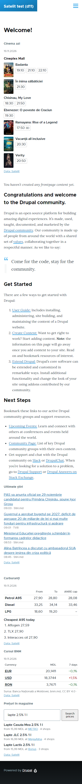
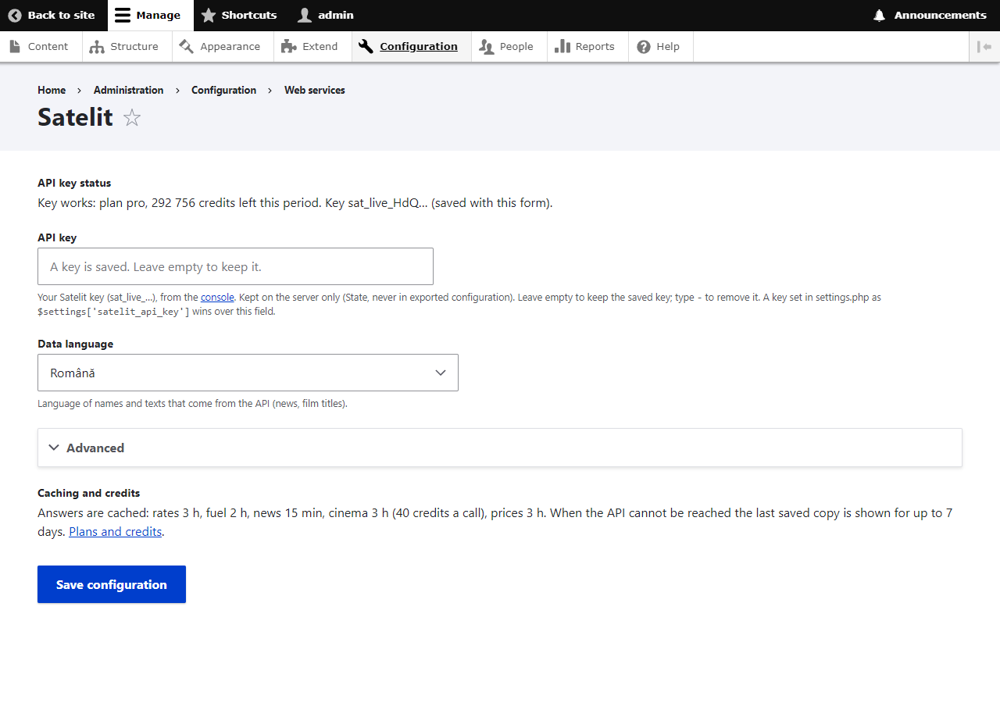

# Satelit for Drupal

A Drupal 10 and 11 module with blocks of Moldova's public data from the [Satelit API](https://developer.satelit.md/en/docs/): **BNM exchange rates, fuel prices, latest news, cinema today and shop prices** (with an optional search for visitors).

<p>


</p>

Real output of the fuel block on Drupal 11 (19 Nov 2026, live API, Romanian data):

```html
<div class="satelit satelit--fuel">
  <p class="satelit__date">19.11.2026</p>
  <table class="satelit__table">…
    <tr><th scope="row">Petrol A95</th><td class="satelit__num">27,90</td><td class="satelit__num">28,80</td><td class="satelit__num">28,08</td></tr>
    <tr><th scope="row">Diesel</th><td class="satelit__num">33,25</td><td class="satelit__num">34,14</td><td class="satelit__num">33,46</td></tr>
  …</table>
  <p class="satelit__sub">Cheapest A95 today</p>
  <ol class="satelit__list"><li>Aflogen <span class="satelit__num">27,59</span></li><li>TLX <span class="satelit__num">27,90</span></li>…</ol>
  <p class="satelit__src"><a href="https://satelit.md" rel="noopener">Data: Satelit</a></p>
```

## Blocks

| Block | Route | Credits per refresh | Fresh for |
|---|---|---|---|
| Satelit: BNM exchange rates | `/v1/rates` | 1 | 3 h |
| Satelit: fuel prices | `/v1/fuel` | 1 | 2 h |
| Satelit: latest news | `/v1/news` | 2 | 15 min |
| Satelit: cinema today | `/v1/movies/cinemas/today` | 40 | 3 h (block re-rendered every 15 min so started sessions drop off) |
| Satelit: shop prices | `/v1/prices/search` + `/v1/prices/items/{id}` per product | 3 + 2 × products | 3 h |

Each block has its own settings (currencies; networks listed; number and category of stories; city and posters; search words, number of products and whether visitors may search). Every block shows the API's attribution when it has one (BNM's line under the rates) and a **Data: Satelit** link; each price shows its shop.

## Requirements

- Drupal 10.3+ or 11, PHP 8.1+
- A Satelit API key (`sat_live_…`): [console](https://developer.satelit.md/en/console/). Plans: [pricing](https://developer.satelit.md/en/pricing/). Trying the data before paying: the keyless [`/v1/sample`](https://api.satelit.md/v1/sample) and the console.

## Install

With Composer (the package installs to `modules/contrib/satelit`):

```sh
composer config repositories.satelit vcs https://github.com/Satelit-Moldova/satelit-drupal
composer require satelit-moldova/satelit-drupal
drush pm:install satelit        # or Extend → Satelit
```

Without Composer: copy this folder to `web/modules/contrib/satelit` and enable it in **Extend**.

## Configure

**Configuration → Web services → Satelit** (`/admin/config/services/satelit`, permission *Administer Satelit*):

- **API key**: saved in Drupal's State, so it never ends up in exported configuration or in git. The field is always empty; an empty field keeps the key, `-` removes it. On a production site you may set it in `settings.php` instead, which wins over the form:

  ```php
  $settings['satelit_api_key'] = getenv('SATELIT_API_KEY');
  ```

  Or from the command line: `drush state:set satelit.api_key sat_live_…`.
- The page shows what the API answers for the key (via `/v1/me`, 0 credits): *Key works: plan pro, 293 485 credits left this period.*, or *The API did not accept the key or could not be reached (key_invalid)*.
- **Data language**: the page language (ro, ru, uk; others English) or a fixed one.
- Advanced: **API address**, empty for `https://api.satelit.md/v1` (tests only).

Then **Structure → Block layout → Place block → Satelit: …**.

## Caching and credits

- The HTTP calls go through Drupal's `http_client` (Guzzle) with a 6 s timeout (3 s to connect); answers are kept in their own cache bin (`cache_satelit`), so a busy site spends one call per block per period whatever its traffic.
- Blocks carry cache tags `satelit:<kind>` and a max-age equal to the data's freshness. Drupal's Internal Page Cache (anonymous visitors) ignores max-age, so `satelit_cron()` invalidates each tag when its time has passed: keep cron running (Automated Cron is enough; run it at least every 15 minutes for the news to move).
- A copy is kept 7 days. When the API cannot be reached or refuses the key, the last copy is shown and calls pause 5 minutes (or the API's `Retry-After`). With no key and no copy a block renders nothing; the page stays up. One warning per failure goes to the `satelit` log channel (Reports → Recent log messages).
- Visitor price search (`?satelit_q=…`) is off by default; when on, Drupal's flood control lets at most 20 new searches per IP per hour reach the API.

## Tested with

Verified on 19 Nov 2026 against the live API, with official Docker images, MariaDB 10.11.19 and Drush 13.8.1: site installed with `drush site:install`, module required through Composer (path repository), enabled with Drush, **key saved through the settings form**, the five blocks placed through Block layout, the front page HTML checked against the API's own answers (EUR 20.1411 = `/v1/rates`, A95 from 27.90 = `/v1/fuel`, a `/v1/news` title, film *Badanta* and its sessions = `/v1/movies/cinemas/today`, "Lapte Casuta Mea 2.5% 1 l" from 15.99 MDL at METRO = `/v1/prices`).

| Drupal | PHP | Image | Checked |
|---|---|---|---|
| 10.6.22 | 8.4.27 | `drupal:10-apache` | settings form, 5 blocks, visitor search, dead API (saved copies, then nothing), bad key; unit tests (PHPUnit 9.6) |
| 11.4.13 | 8.5.12 | `drupal:11-apache` | the same; unit tests (PHPUnit 11.5) |

Drupal 7 is not covered by this module.

## Troubleshooting

| You see | Do |
|---|---|
| A block renders nothing | The settings page says why (`no_key`, `key_invalid`, `plan_required`, `network`); Reports → Recent log messages, type `satelit`. |
| `quota_exceeded` | The period's credits are spent: [pricing](https://developer.satelit.md/en/pricing/). Saved copies keep showing meanwhile. |
| Anonymous visitors see old news | Cron is not running often enough (see Caching). |
| Drush fails with `Call to undefined method Drush\Application::addCommand()` (Drupal 10 + Drush 13.8) | `composer require -W drush/drush "consolidation/robo:<5.2"` (not this module's issue; seen on 19 Nov 2026). |

Errors: [developer.satelit.md/en/errors/](https://developer.satelit.md/en/errors/). Limits: [/en/rate-limits/](https://developer.satelit.md/en/rate-limits/).

## Development

Offline unit tests (Guzzle `MockHandler`, no network), from a Drupal site with `drupal/core-dev`:

```sh
vendor/bin/phpunit -c web/core web/modules/contrib/satelit/tests
# opt-in live smoke test, 2 credits (skipped without the variable):
SATELIT_API_KEY=sat_live_… vendor/bin/phpunit -c web/core web/modules/contrib/satelit/tests/src/Unit/LiveSmokeTest.php
```

## Pe scurt (română)

Modul Drupal 10 și 11 cu blocuri din API-ul Satelit: cursul BNM, carburanți, ultimele știri, cinema azi și prețuri în magazine (cu căutare opțională pentru vizitatori). Instalați cu Composer, salvați cheia la Configurare → Servicii web → Satelit (se păstrează în State, nu în configurația exportată, sau în `settings.php`), apoi plasați blocurile din Aranjarea blocurilor. Răspunsurile stau în cache (știri 15 min, curs 3 h, cinema 3 h); dacă API-ul nu răspunde, se arată ultima copie salvată, iar site-ul merge mai departe. Interfața de administrare e în engleză, prin `t()`, gata de tradus.

## License

MIT, © 2026 Satelit (satelit.md). See [LICENSE](LICENSE). Security reports: [SECURITY.md](SECURITY.md).
